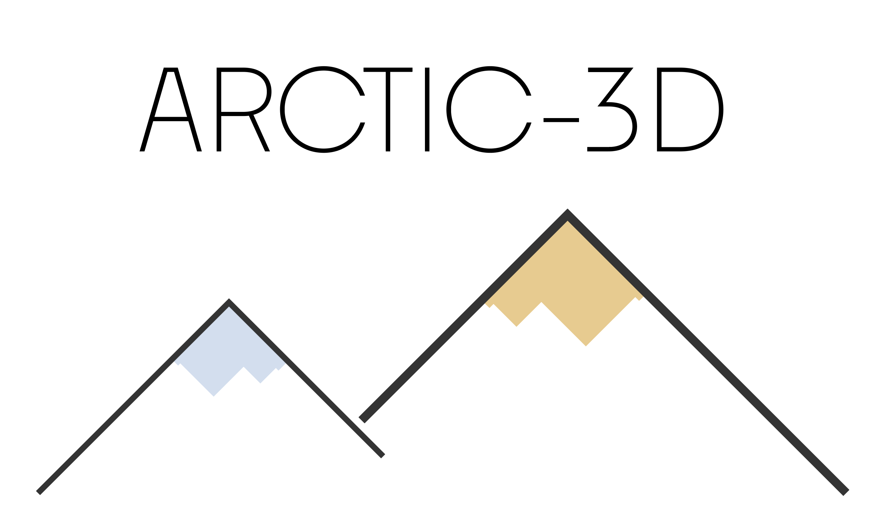

# Web server manual

The ARCTIC-3D web server at <https://wenmr.science.uu.nl/arctic3d> retrieves
all the interfaces of a protein that are known from experimental structures and
clusters them into binding surfaces. You need an account on the portal to
submit a job.

## How ARCTIC-3D works

1. ARCTIC-3D retrieves the interfaces of your protein with its partners
   (proteins, and optionally ligands) from the
   [PDBe graph API](https://www.ebi.ac.uk/pdbe/graph-api/pdbe_doc/).
2. It projects them on one structure of your protein: by default the PDB
   structure that contains the most interface residues.
3. It computes the dissimilarity of every pair of interfaces and clusters the
   interfaces hierarchically: interfaces that overlap on the surface of the
   protein form one binding surface.
4. For each binding surface, it gives the probability of each residue, the
   fraction of the interfaces of that surface it is part of.

## Input

### UniProt ID

The [UniProt](https://www.uniprot.org/) accession of your protein (for
example `P68871`). If you do not know it, search UniProt for the name of your
protein: for *Hemoglobin*, the first result is *Hemoglobin subunit beta*, with
the accession (Entry) `P68871`.

Entering the UniProt ID is enough to submit a job; the other parameters are
optional.

### Interface parameters

- **Uniprot IDs to be excluded**: partners whose interfaces should not be
  considered, comma-separated. For example `P68871` excludes the homodimer
  interfaces of P68871.
- **PDB IDs to be excluded**: PDB entries to leave out of the search,
  comma-separated (for example `7pcq,5jdo`): because you do not trust an
  interface, or to leave it out for benchmarking.
- **Interface coverage cutoff** (default 0.7): the fraction of the residues of
  an interface that must be present in the structure for the interface to be
  kept. With 0.5, at least half of the residues of every interface must be in
  the structure.

### Structure parameters

- **PDB ID to be used**: the PDB entry to project the interfaces on, instead
  of the one with the most interface residues (for example `1dxt`).
- **Chain ID to be used**: the chain of that entry (for example `B`).

### Clustering parameters

The interfaces are clustered with a
[hierarchical clustering](https://docs.scipy.org/doc/scipy/reference/generated/scipy.cluster.hierarchy.linkage.html).

- **Threshold** (default 0.866, an angle of 60°): where the hierarchy is cut,
  below 1. A lower threshold gives a stricter clustering and more binding
  surfaces; a higher threshold gives fewer, more heterogeneous surfaces.
- **Linkage strategy** (default `average`): how the distance between two
  clusters is computed. With `average`, it is the average distance between
  their interfaces.
- **Minimum number of residues in clusters** (default 0): binding surfaces of
  one or two residues carry little biological meaning. With 3, surfaces of fewer
  than three residues are discarded.

### Clustering the partners

The partners of your protein can also be clustered by their
[QuickGO](https://www.ebi.ac.uk/QuickGO/) annotations: subcellular location,
protein function and biological process. Select one or more of the three.

## Output

### Report

The results page shows the ARCTIC-3D report (`report.html`):

- a 3D viewer (Mol\*) with all the binding surfaces on the structure and,
  with **Next**, each binding surface coloured by residue probability, from
  white (0) to red (1);
- a table of the binding surfaces with their number of interfaces and
  residues, their top residues and their partners, and a table of the
  probabilities of all residues; click a column header to sort a table;
- the dendrogram of the clustering and the residue probabilities along the
  sequence;
- with the partner clustering, the bar plots of each binding surface for each
  type of annotation.

For an example, see the [example report](example/arctic3d-P00760/report.html)
of trypsin (P00760), with the three partner clusterings.

### Files

The download contains all the files of the job, among which:

| File | Content |
| --- | --- |
| `report.html`, `state.mvsj` | The report and its 3D views |
| `clustered_interfaces.out` | The interfaces of each binding surface |
| `clustered_residues_probs.out` | The residues of each binding surface, ranked by probability |
| `<pdb>-<chain>_cl<N>.pdb` | The structure, with the probabilities of binding surface N as B-factors |
| `retrieved_interfaces.out` | All the retrieved interfaces |
| `dendrogram_<linkage>.png` | The dendrogram of the clustering |
| `sequence_probability.html` | The residue probabilities along the sequence |
| `arctic3d-localise-<type>/` | The partner clustering of each type |
| `arctic3d.log` | The log of the job |

See [Result interpretation](README.md#result-interpretation) for how to read
them.

To view `report.html` from the download, serve its directory with
`python -m http.server -d <directory>` and open
<http://localhost:8000/report.html>: browsers do not let a page opened from
disk load the files of the 3D viewer.

### If a job fails

The results page shows the output of the job, which often says why it failed
(for example a UniProt ID without interfaces in the PDBe). For help, ask at
<https://ask.bioexcel.eu>.

## Running ARCTIC-3D locally

ARCTIC-3D is also available as a stand-alone program: see
[Installation](README.md#installation) and [Examples](examples.md).

## References

To cite ARCTIC-3D, please refer to:

- M. Giulini, R.V. Honorato, J.L. Rivera and A.M.J.J. Bonvin.
  [ARCTIC-3D: automatic retrieval and clustering of interfaces in complexes from 3D structural information.](https://doi.org/10.1038/s42003-023-05718-w)
  *Communications Biology*, **7**, 49 (2024).
- R.V. Honorato, P.I. Koukos, B. Jimenez-Garcia, A. Tsaregorodtsev, M. Verlato,
  A. Giachetti, A. Rosato and A.M.J.J. Bonvin.
  [Structural biology in the clouds: The WeNMR-EOSC Ecosystem.](https://doi.org/10.3389/fmolb.2021.729513)
  *Frontiers Mol. Biosci.*, **8**, 729513 (2021).
